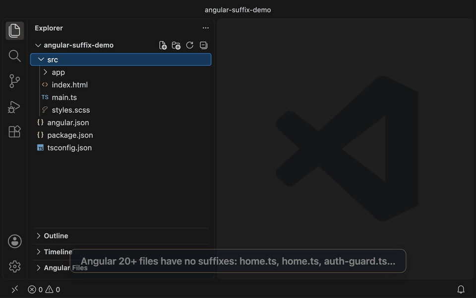

## What changed

For most of Angular's history, the file name told you what was inside it: `home.component.ts`, `home.service.ts`, `auth.guard.ts`. Starting with Angular 20, the [updated style guide](https://angular.dev/style-guide) dropped that recommendation, and the CLI dropped it too. When you run `ng generate component home` now, you get `home.ts` with a class named `Home`. A service gets the same treatment, so a new project can easily have two files that are both called `home.ts`.

The reasoning makes sense. The suffix duplicates information that's already in the code (`@Component`, `@Injectable`). It makes names longer, and it pushes people toward thinking in framework categories instead of naming things for what they do. On disk, I'm fine with it.

My muscle memory isn't. I've spent years opening files with Ctrl+P and a few letters: `hoco` for `home.component.ts`, `hoser` for `home.service.ts`. With suffix-less files, `hoser` finds nothing. If I type `home` instead, I get two identical-looking `home.ts` entries and have to read the folder path to tell which one I want. The file tree, the editor tabs and quick open all became a little harder to read.

## The extension: Angular Suffix Lens

So I built [**Angular Suffix Lens**](https://marketplace.visualstudio.com/items?itemName=ajwiebe.angular-suffix-lens). It reads each TypeScript file in your workspace, works out what kind of Angular thing it is, and shows the suffixed name throughout VS Code. **Nothing is renamed on disk.**

- **Ctrl+P / Cmd+P:** type `hoser` and `home.service.ts` comes up. It opens `services/home.ts` right at the decorator.
- **Explorer badges:** files get a small letter: **C** for component, **S** for service, **D** for directive, **P** for pipe, **G** for guard, and so on. Hovering over a badge shows the full Angular name.
- **Companion files:** `home.html`, `home.css` and `home.spec.ts` follow their component, so `homecomhtml` finds the template.
- **Go to Angular File (Cmd+Alt+P / Ctrl+Alt+P):** a picker ranked by Angular name.
- **An "Angular Files" view** that lists the whole project by its Angular names.
- **Editor tab titles** with the suffix (opt-in).

Detection is driven by settings. Each rule is a regular expression plus a suffix and a badge, and the first match wins. The defaults cover components, directives, pipes, NgModules, guards, interceptors, resolvers and services, including the newer `@Service()` decorator. If your team has its own conventions (stores, facades, effects), you can add rules for them in `settings.json`. Setting the list replaces the defaults, so copy the default rules in first and then add your own:

```json
"angularSuffixes.rules": [
  { "suffix": "store", "pattern": "signalStore\\s*\\(", "badge": "St" },
  // ...followed by the default rules
]
```

### How it works

VS Code doesn't let extensions change how the built-in Ctrl+P matches file paths, and it doesn't let them rename items in the Explorer. Both of those are deliberate, and they're the right call. What it does allow:

1. A **workspace symbol provider**. The extension registers every Angular file as a symbol named after its Angular name (`home.service.ts`). With `search.quickOpen.includeSymbols` turned on, those symbols show up in the normal Ctrl+P list, so `hoser` just works. The extension offers to turn that setting on for you.
2. A **file decoration provider** for the Explorer badges and tooltips.
3. VS Code's **custom editor labels** setting, for tab titles.

Indexing happens once on startup and is then kept current by a file watcher. It respects `files.exclude` and `search.exclude`, and it skips very large files.

### Try it

```bash
code --install-extension ajwiebe.angular-suffix-lens
```

Or search for "Angular Suffix Lens" in the Extensions view. The source is on GitHub at [alexanderwiebe/angular-suffix-lens](https://github.com/alexanderwiebe/angular-suffix-lens) under the MIT license. Issues and pull requests are welcome, especially new detection rules.

## Closing thoughts: source code for the machine, views for the human

The naming debate for Angular files always assumed there was one correct name, and that the file system was where it lived. One side wanted names that were short and honest. The other side wanted names that were easy to scan and search. Both are right, because they're optimizing for different readers.

The compiler, the bundler and git don't care what a file is called. People reading a file tree or hunting for a file in quick open care a lot, and what they need changes with the task. When I'm navigating, I want `home.service.ts`. When I'm reading imports, `home` is plenty. A new team member might want every file labeled. Someone who has lived in the codebase for years might want nothing extra on screen at all.

We already accept this split everywhere else. Syntax highlighting, inlay hints, code folding, git blame annotations and type-on-hover are all layers the editor draws over the source to help a person understand it, and none of them get saved into the file. File names have been the exception only because the file system is so literal.

I think that's the direction to keep pushing. Keep source code minimal and settle it for the machine: one canonical form, with no duplicated metadata and nothing extra to argue about in code review. Then let tooling project that source into whatever form makes the most sense to the person looking at it, on their screen and on their terms. The disk can say `home.ts`. My editor can say `home.service.ts`. Neither one has to be wrong.
